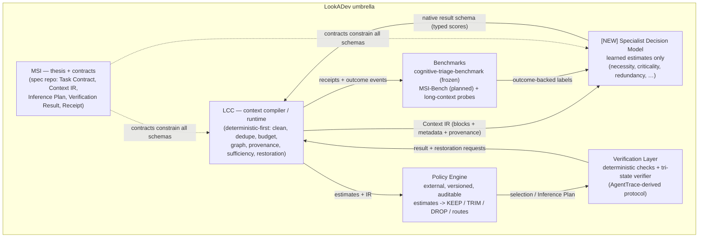
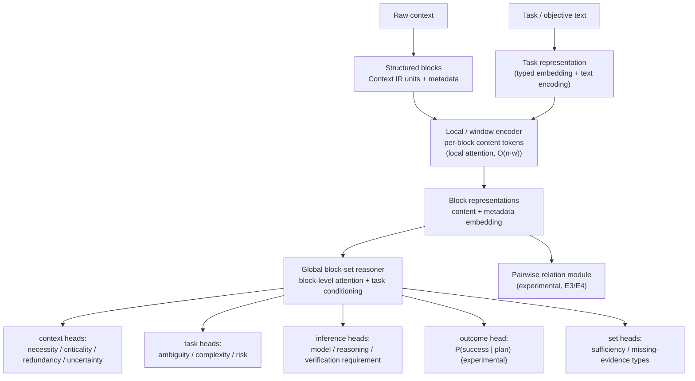
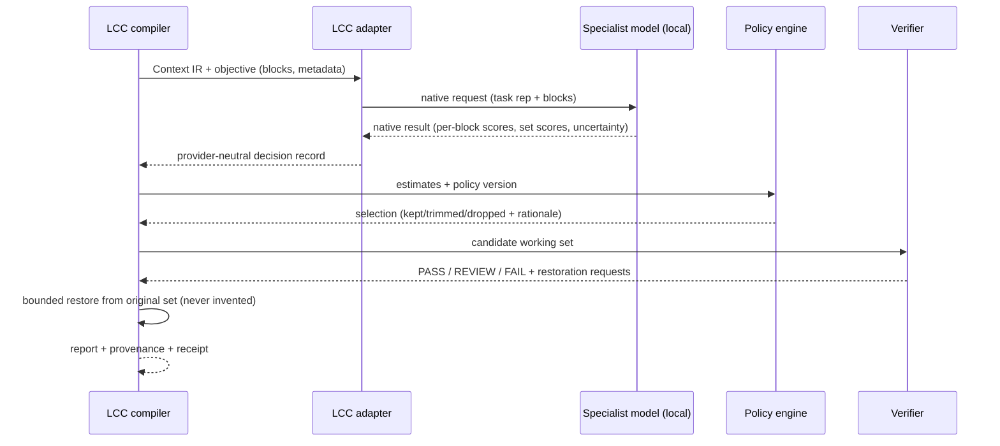

# 03 — Target Architecture (v0)

Status: Sprint 0. Conceptual target; nothing here is final before the Sprint 2 bake-off.

## 1. Family map



Roles stay separated: LCC owns the IR, provenance and restoration; the model owns
estimates; policy owns decisions; verification owns the tri-state; benchmarks own
evidence. The model **never** replaces LCC and never writes to the context.

## 2. Model internal architecture (investigation target: long-context + block-aware + multi-task)



Key structural bets (each behind an ablation gate):

1. **Local-then-global attention**: token-level window attention inside blocks, then
   attention across block representations. Avoids naive O(n²) full attention at 32K/64K
   while keeping cross-block reasoning.
2. **Structure is given, not learned**: block boundaries, source, tool, order,
   protected status and dependency edges come from LCC's IR. The model learns judgments
   over structure, not structure itself.
3. **Shared backbone, typed heads**: curriculum trains heads progressively (§6);
   heads can be swapped/ablated without retraining the backbone.
4. **Uncertainty everywhere**: every head emits calibrated confidence; the policy layer
   treats low confidence as KEEP/ESCALATE.

## 3. Decision flow at runtime (LCC consumer view)



Failure semantics at every arrow: missing model → mechanical fallback with
`degraded: true` and `semantic_guarantee: none` (existing LCC contract, LAYA.md §5);
failed inference keeps content; the model can abstain and the policy preserves.

## 4. Provider contract (native result, v0 draft)

Provider-independent; LCC adapts it to `relevance-compaction-1.2` decisions:

```json
{
  "schema_version": "lookaspecialist-result/0.1",
  "model_version": "name-tier-ckpt",
  "config_version": "encoder-heads-...",
  "blocks": {
    "blk_0001_ab12cd": {
      "necessity": 0.94,
      "criticality": 0.77,
      "redundancy": 0.04,
      "uncertainty": 0.03
    }
  },
  "global": {
    "context_sufficiency": 0.91,
    "task_complexity": 0.65,
    "task_ambiguity": 0.30,
    "task_risk": 0.12
  },
  "abstained": ["blk_0007_..."]
}
```

Policy (external) turns this into KEEP/TRIM/DROP. Illustrative (thresholds are policy,
not truth): `necessity 0.20 / criticality 0.10 / uncertainty 0.05` may DROP on a low-risk
task, while `necessity 0.20 / criticality 0.80` must KEEP.

## 5. Training curriculum (staged; each stage gates the next)

| Stage | Learns | Supervision | Gate to proceed |
|---|---|---|---|
| 1 Domain representation | code, diffs, tests, logs, stack traces, tool traces, transcripts, JSON/YAML/MD, issues, PRs, config | self-supervised / continued pretraining | representation probes beat frozen generic encoder |
| 2 Task ↔ context | relevance, source relations, duplicates, dependencies, contradictions, supersession | teacher labels (curriculum only) + deterministic graph | B1/B4/B5 beat baselines |
| 3 Context necessity | necessity, criticality, redundancy | **outcome-backed ablation labels** | beats relevance-only training (H3 test) |
| 4 Set-level sufficiency | sufficiency, missing-evidence types, drop-induced gaps | paired set replay | S1 calibration usable (ECE gate) |
| 5 MSI decisions | complexity, risk, model/reasoning/verification requirement | multi-config replay + triage ground truth | false de-escalation under ceiling |
| 6 Outcome prediction | P(success \| candidate plan) | outcome receipts | only if 5 produced trustworthy data |

Overengineering gates (prompt §42): if the block-aware hierarchy does not beat a simple
pair scorer, simplify before adding more hierarchy; if 32K gives no measurable gain over
8K on the probes, diagnose before pursuing 64K.

## 6. Backbone tracks (decision deferred to Sprint 2)

| Track | What | When it wins |
|---|---|---|
| A — existing encoder baseline | ModernBERT-class / Laya / other encoders + heads | if frozen/fine-tuned encoders already reach effective 32K with good calibration |
| B — adapted long-context encoder | continued pretraining + position extension + block-aware input layer | likely sweet spot: proven representations + our structure |
| C — native model | small, long-context, block-aware, multi-task from scratch | only if A/B cannot use >8K effectively at 30–150M |

All three are compared on the same frozen benchmark (05). The current local evidence
(Laya fine-tune: memorization, 1024-token ceiling) argues against naive Track A and for
testing Track B first — but the bake-off decides, not the preference.

## 7. Where each piece lives (target repo boundaries)

```text
[NEW REPO] (name pending — see 06)     model weights, training pipeline, datasets,
                                       benchmark lifecycle, export pipeline
LCC                                    consumes model via provider/adapter only
minimum-sufficient-inference           schemas/contracts only (read-only upstream)
cognitive-triage-benchmark             frozen triage evaluation set (read-only)
agenttrace-studio                      verification protocol source (extract, no import)
```

No repository is created until the architecture decision (Sprint 1–2) — hypothesis:
`lucasmartins-ai/[chosen-name]`, separate from LCC because it owns weights, training
and dataset lifecycle.
