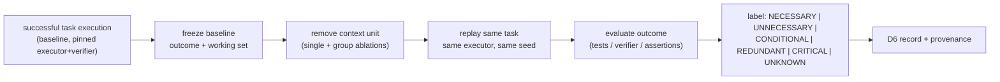

# 04 — Dataset Strategy (v0)

Status: Sprint 0. Governing principle: specialization is in **function and task
distribution**, not in memorizing one repository (prompt §19).

Mandatory class labels (inherited from MSI research methodology):

```text
REAL | REAL-ANONYMIZED | REPLAYED | CURATED | SYNTHETIC | HYBRID
```

Every split, record and claim carries its class. SYNTHETIC is never described as
production.

## 1. The lesson that shapes this strategy (already measured)

The `laya-lcc-relevance-v1` fine-tune (2026-09-23) trained on 7,760 items from the LCC
corpus factory and scored 100% category recall in-domain — then **dropped 6/6 evidence
blocks** on an independently worded ablation corpus. The corpus figures were
memorization of ten fixed evidence sentences. Rules that follow:

1. **No fixed-sentence evidence.** Synthetic items must be programmatic: generated
   facts with noisy tails, paraphrase families, varied structure.
2. **OOD gate before quoting any number.** A checkpoint must pass the judge-ablation
   corpus and adversarial suite before any in-domain metric is reported.
3. **Evidence and noise must come from different generators** than the training items.

## 2. Dataset families

| Family | Content | Class | Primary targets | Source |
|---|---|---|---|---|
| D1 Synthetic bootstrap | programmatic fact-bearing blocks + distractors over generated tasks | SYNTHETIC | B1–B4 warm start | corpus factory v2 (no fixed sentences) |
| D2 Curated dossiers | hand-built task/context sets with labeled critical evidence | CURATED | B2, B3, S1 | practitioner-built (builder + selection rule recorded) |
| D3 Real traces | agent sessions, tool calls, coding/debugging/research transcripts | REAL / REAL-ANONYMIZED | B2, T1–T3 | agenttrace-studio artifacts, local agent sessions (consent!), Hermes sessions (anonymized) |
| D4 Replayed tasks | anonymized traces re-executed against pinned versions | REPLAYED | I1–I5, outcome labels | LCC runs, benchmark harnesses |
| D5 Teacher-labeled | Jev / large-LLM soft judgments | HYBRID | curriculum only (Stage 2) | Jev ledger (`logs/typesafe/jev.jsonl`), batch jobs |
| D6 Outcome-backed | remove-and-replay ablation records (below) | REAL/REPLAYED/CURATED per origin | B2, B3, S1, O1 — **the core asset** | ablation harness (new infra) |
| D7 OOD / adversarial | judge-ablation corpus, `run_adversarial.py` cases, paraphrase + cross-language + dependency traps | CURATED | evaluation only | LCC `benchmarks/research/` (30 adversarial cases exist; expand) |
| D8 Frozen evaluation | MSI-Bench v1 + long-context probe suite | CURATED/REAL mix, frozen pre-training | final evaluation | new; frozen by content hash before any training |
| D9 Domain corpus | code, diffs, tests, logs, stack traces, JSON/YAML/MD, issues, PRs, config | SYNTHETIC/CURATED/public | Stage 1 representation + tokenizer study | public repos (license-clean), LCC repo corpora |

## 3. Outcome-backed generation (the primary supervision machine)



Labeling rule: default is `UNKNOWN`; a label exists only with paired evidence (baseline
vs ablation outcome). `CONDITIONAL` requires a second ablation against the conditioning
block. Deterministic layer-1/2 signals (protection, graph links) are recorded alongside,
never conflated with outcome labels.

## 4. Record schema (refined v0.1 — to freeze in Sprint 1)

```json
{
  "schema_version": "looka-dataset-record/0.1",
  "task_id": "uuid",
  "task_class": "coding | debugging | investigation | research | multi_tool | structured_decision | long_running | other",
  "objective": "verbatim objective text",
  "context": [
    {
      "block_id": "blk_0001_ab12cd",
      "content": "verbatim bytes",
      "metadata": {
        "source": "path:lines | tool:call_id | url",
        "block_type": "code | diff | test | log | trace | json | yaml | md | issue | pr | doc | terminal | config | prose",
        "tool": null,
        "position": 12,
        "protected": false,
        "dependencies": ["blk_..."],
        "provenance": {"origin": "string", "collected_at": "rfc3339", "transform": "none | clean | dedupe"}
      }
    }
  ],
  "candidate_block": "blk_0001_ab12cd",
  "baseline": {"executor": "name@version", "verifier": "name@version", "outcome": "...", "evaluation": {}},
  "ablation": {"removed_blocks": ["blk_0001_ab12cd"], "outcome": "...", "evaluation": {}, "seed": 0},
  "labels": {"necessary": "NECESSARY", "critical": null, "redundant": null, "conditional_on": []},
  "provenance": {
    "dataset_type": "REAL | REAL-ANONYMIZED | REPLAYED | CURATED | SYNTHETIC | HYBRID",
    "generator_version": "corpus-factory@sha",
    "evaluator_version": "name@sha",
    "content_hash": "sha256 of normalized context+objective"
  }
}
```

Refinements vs the prompt sketch: `task_class` and `executor/verifier` versions on the
baseline (outcome means nothing without them — MSI theory: minimality is scoped to a
recorded executor/policy/dataset version), `conditional_on` for CONDITIONAL labels, and
a `content_hash` for split disjointness. Group ablations reuse the record with
`removed_blocks` length > 1.

## 5. Leakage and contamination rules (frozen before training)

1. Train / calibration / evaluation splits are disjoint by content hash. Fixture ids used
   for calibration are listed; reuse as evaluation is forbidden.
2. Any generator or model version touching data is pinned on the record.
3. D7 (OOD/adversarial) and D8 (frozen eval) **never** appear in training, prompt
   design, or threshold tuning. Thresholds tuned on calibration split are recorded as
   policy versions.
4. Teacher (Jev) labels never enter evaluation sets. Evaluation = outcome-backed or
   human-curated ground truth only.
5. Same-repository task families are split *across* train/test only with whole-family
   grouping (no near-duplicate sessions across splits).
6. Public-repo Stage-1 corpus is screened so benchmark tasks can never come from repos
   in the eval set.

## 6. Scale sketch (order-of-magnitude planning only)

| Stage | Needs | Where it comes from | Bottleneck |
|---|---|---|---|
| 1 representation | 10s of GB text (code/logs/traces) | public + synthetic | tokenizer/filtering |
| 2 relations | 10K–50K labeled pairs | deterministic graph + teacher + curation | contradiction/supersession scarcity |
| 3 necessity | 50K–200K ablation records | D6 harness at scale | **replay compute cost** — biggest infra item |
| 4 sufficiency | 10K+ set-level replays | grouped ablations from D6 | evaluator reliability |
| 5 MSI | 5K–20K multi-config replays | D4 + triage set | cost; risk labels |
| 6 outcome | as much as 5 produces | receipts | — |

## 7. Frozen evaluation (built before training starts)

- **MSI-Bench v1**: task/context dossiers with outcome-backed ground truth, stratified by
  task class and dataset class, frozen by hash in Sprint 1.
- **Long-context probe suite** (05 §4): critical-evidence placement at 2K/8K/16K/24K/
  32K/48K/64K + multi-hop triads (evidence A @2K, dependency B @31K, qualifier C @61K).
- **OOD/abstention suite**: paraphrase, cross-language, adversarial, distractor-heavy;
  also measures whether the model abstains when it should.
