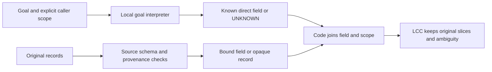

# Research handoff payload — 2026-10-08

Purpose: retain the verified current state and proposed next decision for the local specialized engine + LCC. The latest user request invokes lcc-compact only; it does not launch the proposed probe or training. The broad goal remains incomplete. This is a fresh file payload, not a replacement of the live chat or a measured chat-cache saving. Source excerpts are verbatim; relative references resolve against the original source path named above each excerpt.

## Protected source: /Users/Master/Downloads/LCC-judge/research/goal-engine-2026-10-04/PLAN.md

# Goal — motor especializado + LCC

Iniciado em 2026-10-04 por autorização explícita do usuário para concluir o plano.
Originalidade é avaliada no conjunto motor + LCC, não exigida do motor isolado.
Motivação: a janela útil da Laya limita seu uso; reduzir o escopo semântico para
aumentar contexto útil, qualidade e eficiência local. Adaptar backbone é permitido.

Estado consultado em2026-10-08: a ferramenta do goal informa `usageLimited`.
O objetivo ainda não foi alcançado. A avaliação final local terminou e rejeitou
as três seeds; a auditoria independente dos recibos passou.
[piloto e redirect atuais](wording-development-pilot-v1/RESULTS.md) registram recibos e próximos
passos. Os registros ACTIVE anteriores são históricos, não promessa de novas
continuações automáticas enquanto esse limite estiver presente.

O diagnóstico offline do final está concluído; cutoffs hipotéticos não cumprem
remoção/UNKNOWN e não foram adotados. O piloto seguinte também terminou: seed101,
três epochs finitos, validação pooled .625629 / within .694824, rejeição .001953 e
UNKNOWN binário .998047. Auditoria independente dos recibos passa com errata
explícita do caminho relativo original. 247 testes / zero skips em 17.904s. A sequência
executada está fechada como falha. A [revisão semântica](semantic-goal-review-v1/REVIEW.md)
está concluída como evidência exploratória, sem revisão humana independente.
Recomenda interpretar o objetivo uma vez e selecionar campos ligados à fonte;
a API tipada existente exige metadados ausentes nos registros atuais. A hipótese
ainda não foi implementada ou validada. Próxima proposta: congelar o contrato de
oito campos e um único probe de interpretação, antes de decidir sobre outro treino.
O gate de claims bloqueou a certificação MEASURED dos novos números; recibo e
qualificação preservados no relatório. Não lançar mais seeds/finais no piloto rejeitado.

## Contrato de execução

- Preservar raw scores, recibos, protocolos e checkpoints históricos.
- Congelar fontes antes de corrigir; verificar história com fontes arquivadas.
- Testes de regressão falham antes da correção; não usar APIs para matemática.
- Sem retries seletivos, treino nos holdouts ou troca de gate para fabricar sucesso.
- Publicação externa/default do LCC dependem de conclusão dos gates e autorização
  específica para publicação; preparar tudo localmente.
- Não marcar o goal como concluído enquanto houver trabalho necessário; limites
  de uso da ferramenta não são conclusão nem pausa solicitada pelo usuário.


## Protected source: /Users/Master/Downloads/LCC-judge/research/goal-engine-2026-10-04/semantic-goal-review-v1/REVIEW.md

# Semantic goal review and recommended route — 2026-10-08

## Recommendation and research scope

Test a small goal interpreter followed by selection over source-bound fields.
Interpret the question once; let code join a supported field to records. Keep
unknown goals and opaque records. This is a proposed change of task/representation,
not evidence that the architecture already works or replaces Laya/Jev.

The target is useful, efficient local context in engine + LCC. A finite semantic
contract is compatible with that goal, but direct measurement retrieval covers
only part of LCC's broader relevance decisions. General incident diagnosis and
the sufficiency of a retained set remain open. The failed historical gates are
unchanged; narrowing a future prototype cannot make those results pass.

## What was actually reviewed

`review.py` checks the saved train/validation inputs against all 96 original raw
fixtures, with no tool recapture or model inference. It extracts a fixed 96-case
validation sample: 8 fields × 2 query languages × (positive, negative, three semantic
UNKNOWN kinds, one malformed-record kind). Positives prefer contradictory values;
negatives prefer original measurements; selection then uses ID without scores.
All 4 actual DROP rows are added as a separate supplemental sample, for 100 rows.
This coverage sample is not a random prevalence estimate or 100 independent tasks.

The semantic assessment is by the same coding agent, informed by source definitions
and official references. **It is not independent human labeling.** Source/raw/
input/selection integrity checks pass. There are no conflicting question targets
under the authored contract. A separate gzip/JSON recount confirms these counts:

| Population | Rows | Distinct direct questions, entity suffix removed | Direct questions per field, both languages |
| --- | ---: | ---: | ---: |
| Train | 11,136 | 256 | 32 |
| Validation | 5,568 | 240 | 30 |

Different counter values, captions, entities and swaps multiply pair rows without
creating new natural questions. The total distinct question populations are
1,172/1,136 including UNKNOWN and structural cases. Some structural questions
overlap direct questions. Row count does not establish semantic diversity or the
number of independent observations. Counts alone do not prove a cause of failure.
The current loss already balances classes globally after deduplication; a high
UNKNOWN fraction is not sufficient evidence of an unbalanced-loss bug.

Receipts: `protocol.json`, `summary.json`, `cases.json`,
`independent-count-check.json`, `compatibility-probe.json`, `verification.json`.
The automated claim gate returned **BLOCK (.65 support)** for publishing the
combined counts/compatibility statement as MEASURED: it requests repeated
measurement or an independent source. Its required label is
`INFERIDO — nao medido (falta medicao repetida ou fonte independente)`;
see `result-claim-gate.json`. Preserve the local receipts and treat this review as
exploratory evidence, without independent scientific certification. No retry or
change of the claim gate was made. The architecture recommendation remains a
hypothesis. All review annotations
are diagnostic targets; none enter a candidate's inference or training.
The extractor/probe's zero API/model-call counts exclude the one supplementary
external Jev claim-gate call. Its receipt does not record token/cache accounting;
it is not model-quality or independent semantic-label evidence.

## Findings

**1. Two language interpretations are combined in every model input.**
[Projection](../../measurement_projection.py) validates caller entity/syntax but
passes only the natural question and `measurement prose: value` to the model
(lines 46–56). The canonical source field and unit live in the supervision binding,
not the submitted strings. Thus a ranking error may involve question interpretation,
caption interpretation, the relation between them or support gating. The saved
two logits do not locate these errors independently. Their separation in the loss
does not make their shared encoder or pair inputs independent.

**2. The reviewed literal field targets largely make sense, with scope caveats.**
No definite swapped source-field label was found in the 32 binary coverage cases.
Attempts/failures, scheduled/actual waits, datagrams/payload bytes and staged/
worktree paths are distinct under the captured definitions. Relevant false values
remain relevant: filtering them as impossible would erase contradictory evidence.

| Fields | Meaning to preserve |
| --- | --- |
| Retry attempts / failures | All protected-operation calls, including a terminating success or failure / only calls that raised |
| Scheduled / actual waiting | Sum of requested intervals / monotonic sleeper-callback entry-to-exit durations, excluding operation calls |
| Sent UDP datagrams / bytes | Successful local send events, including empty datagrams / application payload lengths, excluding headers |
| Git staged / worktree paths | HEAD-to-index changes / index-to-disk changes; additions/deletions and tracked-path scope must be explicit |

Some captions weaken that precision. Git captions saying "modified" may be read
as status M alone even though these counts include additions/deletions; see sample
cases 0/3 and the [Git status definition](https://git-scm.com/docs/git-status/2.45.0).
Some English duration captions omit the unit, while the recorded integer uses
nanoseconds; case60 is an example. UDP "transmitted" should explicitly mean local
`sendto` submission, not successful receipt. Python documents the
[sendto return](https://docs.python.org/3.13/library/socket.html#socket.socket.sendto),
and [RFC768](https://www.rfc-editor.org/info/rfc768/) does not guarantee delivery.
These are future wording/contract corrections, not proven explanations of the
observed quality failure. Historical strings and labels remain unchanged.

**3. There are clear model failures, even on an unambiguous reviewed query.**
Supplemental IDs `1a531b981b4f…` and `935ca02d20a4…` ask in Portuguese for the
observed retry pause duration in nanoseconds. Both matching captions say observed
time inside the sleeper in nanoseconds. The policy drops the true 5,803,500 ns
record and its contradictory 3,000,000 ns value swap. This is direct evidence of
failed relevance/retention on those inputs, not a causal diagnosis of the encoder.
The 2 negative DROP rows are one duplicated effective input under the same Git
query; all 4 DROP rows represent 3 effective inputs and 2 questions, not 4 independent
errors. The original row-denominator metrics remain valid as defined.

**4. UNKNOWN has two materially different meanings.**
The 48 semantic-UNKNOWN coverage cases ask for derivation, explanation or broader
analysis. Abstention is correct under the direct-record contract, even if those
records could help a larger task. The 16 structural cases have valid direct-field
questions but malformed records missing `level`. An interpreter trained only on
goals must not label those questions unsupported merely because the pair's label
is UNKNOWN. Query support and record validity require separate targets.

The [UNKNOWN templates](../../wording_development_pilot.py) explicitly label
broader context usefulness unsupported. More epochs on that target do not teach
general LCC relevance. Some composed questions are also unnatural, such as
"Determine por que ocorreu caminhos distintos…". Future data need complete
utterances and genuinely ambiguous/out-of-scope requests, not repeated frames
whose first verb effectively announces the target class.

**5. The existing typed API cannot consume these records unchanged.**
[ObservationRequest](../../../lcc_engine/observations.py) requires entity, field and
UTC start/end; its JSON record grammar requires time, level, entity, field, value,
unit (lines 32–58). Pilot JSON has entity, level, measurement, value; prose has no
timestamp either. A compatibility-only probe with one literal valid request keeps
all 5,568 validation rows UNKNOWN and drops none. Its request's UTC range is synthetic,
not a claimed capture timestamp. Adding a classifier in front of this API does
not bridge the record-schema gap.

## Alternatives

| Approach | What it can answer | Limitation / decision |
| --- | --- | --- |
| Goal interpreter + source-bound selection | Whether a natural request maps to a known recorded field; record selection becomes inspectable | Recommended probe; needs trusted field adapters, new labels and explicit unsupported scope |
| Continue the pair cross-encoder | General question/caption relation, potentially broader inputs | Useful control; more of the same does not isolate the transfer failure or reduce per-block semantic work |
| Refit scores/cutoffs per goal | Differences of score scale between questions | Cannot fix within-goal ordering or missing record metadata; diagnostic only at this stage |

## Proposed flow



The interpreter reads goal text and a public fixed field registry, plus caller
identity already supplied explicitly. It never receives `requested_role`, labels,
fact_truth or desired decisions from benchmark annotations. In an initial
eight-field study it may select a supported direct field or abstain. Canonical
field bindings must come from genuine tool schemas/collector definitions,
independently verified against raw events. They cannot be copied from dataset
labels into arbitrary prose. Records without such bindings remain opaque/KEEP.

Reuse the existing parser/projection and original-slice retention principles.
Tool captures without an observed UTC window use a declared capture/instance
scope; do not fabricate timestamps or silently reinterpret ObservationRequest.
If a producer already supplies valid UTC records, reuse that API directly. A
record's questionable value is not grounds to discard a matching-field record.
Broader goals retain context; this prototype does not plan an incident investigation.

The efficiency hypothesis is semantic work per distinct goal instead of per
goal/block pair, followed by bounded parsing. It does not imply a smaller weight
file, lower measured latency or native 32K attention. Those require measurement.

## Ordered next experiment and stopping rules

1. **Freeze the registry and support contract.** Define the eight fields, units,
   success/failure semantics, caller scope and unsupported request kinds. Correct
   future ambiguous captions. Prepare complete natural requests, separating
   question targets from record-validity targets. Success: every accepted request
   has one explainable field binding; unresolved ambiguity remains UNKNOWN. Obtain
   independent semantic review before presenting those labels as scientific ground
   truth; none is currently available in these receipts.

2. **Run one goal-only development probe before training.** Reuse the immutable
   multilingual reranker and lexical controls against fixed field/unsupported
   definitions. Only exposed development queries; one protocol, at most 30,000
   local pair forwards, no adaptation or external model calls. Freeze exact
   definitions, token counts, scoring/cutoff recipe and failure accounting first.
   Report field confusion, accepted-binding precision, supported-query coverage
   and unsupported acceptance by language and wording family. Success for the
   eventual router: accepted precision ≥.99 and coverage ≥.80 on supported queries,
   semantic UNKNOWN recognition ≥.95. These are proposed point targets, not a
   confidence guarantee. If the frozen probe fails, inspect errors before deciding
   whether a separately bounded query-only adaptation is justified.

3. **Use fresh query families to confirm an interpreter, then test full selection.**
   Reserve at least 256 complete new requests per language, including supported,
   unsupported, negated, underspecified and out-of-registry requests. Group
   translations/paraphrases of the same intent in one split; count unique queries
   rather than repeated counter values. Have at least 100 accepted unique queries
   per language when estimating precision, and report confidence intervals with
   the point estimate. A small successful sample is not a 1% error guarantee. All
   thresholds must be frozen on separate development before confirmation.

   Provide every compared engine the same canonical metadata; report the schema
   change as a system treatment, not a pure neural-model improvement. Use a
   typed/oracle request only as a labeled diagnostic ceiling, never a prediction.
   Require the original end-to-end semantic pooled/within-goal ≥.90,
   positive/contradiction retention ≥.95, negative DROP ≥.70, semantic UNKNOWN ≥.95,
   structural UNKNOWN 1.0 and zero UNKNOWN DROP by query/report language. A future
   eight-field pass does not certify the old 18-field gate or broader LCC utility.

4. **Only a confirmed useful selector proceeds to LCC outcomes and compression.**
   New full/local/Laya/Jev tasks at 8K/32K/larger; success ≥.90, loss ≤.02,
   removal ≥.25 and UNKNOWN retained. Measure cold/warm latency, full process RSS,
   tokenizer/model/parse calls and full token/cache accounting. Prefer measured
   lower total cost; distillation/quantization follows useful quality. P2 still
   needs reliable replay and independent outcome review.

Do not spend the next cycle on larger attention windows, extra seeds/epochs of
the rejected pilot, new backbones, benchmark-based cutoff fitting or public
performance claims. The first new executable work should be the goal-only probe
after its small protocol is frozen; no production code or new training was
implemented in this review.

Verification: extractor self-check covers structural/direct/unsupported targets
and missing caller scope; full sample/raw/input assertions and separate count
check pass. Scoped Ruff E9/F passes. The first extractor preflight compared a
normalized view's extra hash key incorrectly; `preflight-errors.log` preserves
the failure, corrected before exporting review receipts. No original evidence
changed. The prior 247-test suite remains the last full-suite result; this review
adds only research artifacts. Reproduction in a temporary output directory matches the saved protocol, summary
and all cases apart from creation timestamps, with 20 pinned input/source hashes
checked (`verification.json`). The saved script writes exclusively and refuses
to replace these receipts. From the repository root, reproduce its checks with:

```python
import contextlib, importlib.util, io, json, tempfile
from pathlib import Path
saved = Path("research/goal-engine-2026-10-04/semantic-goal-review-v1").resolve()
spec = importlib.util.spec_from_file_location("semantic_review", saved / "review.py")
module = importlib.util.module_from_spec(spec)
spec.loader.exec_module(module)
with tempfile.TemporaryDirectory() as directory:
    module.OUT = Path(directory)
    with contextlib.redirect_stdout(io.StringIO()):
        module.review()
    for name in ("protocol.json", "summary.json", "cases.json"):
        actual = json.loads((module.OUT / name).read_text())
        expected = json.loads((saved / name).read_text())
        if isinstance(actual, dict):
            actual.pop("created_at_utc", None)
            expected.pop("created_at_utc", None)
        assert actual == expected, name
```

## Protected source: /Users/Master/Downloads/LCC-judge/research/goal-engine-2026-10-04/REPORT.md — latest decision and closed pilot

# Engine + LCC — validation checkpoint, 2026-10-08

## Current recommendation: interpret the goal once, then select source-bound records

The [semantic goal review](semantic-goal-review-v1/REVIEW.md) checks all saved
inputs against raw fixtures and reviews a fixed 96-case coverage sample plus
four supplemental DROP rows. Reproduction matches the protocol, summary and
all cases apart from creation timestamps. This is exploratory agent review,
not independent human labeling. The new combined count/compatibility claim's
automated gate returned BLOCK (.65 support), requesting repeated measurement
or an independent source; its required inference label and receipt are preserved.

The model receives a natural question and a prose caption/value; canonical
fields/units exist only in supervision bindings. Structural UNKNOWN may have
a valid direct question, whereas semantic UNKNOWN deliberately excludes broad
LCC usefulness. The existing typed API requires source/time metadata that the
pilot records lack. No definite field-label swap was found in the 32 binary
coverage cases; this is a sample finding, not a full-corpus certification.

Recommendation: freeze an eight-field registry and query-support targets,
run one bounded goal-only development probe using existing immutable weights
and lexical controls, then reserve fresh whole question families for confirmation.
Accepted-binding precision ≥.99, supported coverage ≥.80 and semantic UNKNOWN
recognition ≥.95 are proposed router targets. Full selection and LCC outcomes
retain their original gates. Field adapters must use genuine source definitions;
no gold target inputs or invented UTC timestamps. No new training, provider or
default change was implemented. Useful replacement remains unvalidated.

## Previous continuation: saved-final diagnosis complete; wording pilot rejected

The zero-forward [saved-final diagnosis](varied-relation-confirm-v1/failure-diagnosis-v1/RESULTS.md)
reproduces all original aggregate metrics. With original support cutoffs, fitting
relevance to preserve .95 retention in all 24 cohort/language constraints still
rejects .370047/.404361/.346890 of negatives and drops 132/140/75 semantic UNKNOWNs.
Preventing those drops reduces rejection to .019518/.075534/.096737. These are
explicitly exposed-final diagnostics, not serving thresholds or an exhaustive
two-axis optimum. Original weights, scores and cutoffs are unchanged.

A separate [held-goal-wording development pilot](wording-development-pilot-v1/RESULTS.md)
reuses 64/32 actual author fixtures on 8 relevance fields and 4 within-tool pairs;
18 fields remain in semantic UNKNOWN. There are 11,136/5,568 rows, zero split-input
overlap or cuts; independent raw/label/full-tokenizer audits pass. Goal/frame
wording is disjoint by split;
report vocabulary stays known. Scope, class mix and workload change jointly.
Fixed seed101 and 3 finite CPU epochs complete: 2,649 updates / 42,318 training pairs /
1,796,904 tokens. Train/validation pooled .840858/.625629, validation within .694824,
negative DROP .001953, binary UNKNOWN .998047. Validation has zero explicit KEEP,
2 positive DROP / 1,022 UNKNOWN and 2 negative DROP / 1,022 UNKNOWN. Both policies fail.
Scalar validation pooled .586981 / within .644043, shadow only. Total evaluation
22,016 forwards / 940,508 tokens includes the scalar. Exit0 at 2026-10-07T23:10:02Z; all
local training/scoring complete. Independent audit rederives inputs/updates/
calibration/metrics/private frozen weights with zero audit forwards and an explicit
preserved relative-path metadata erratum. 247 tests / zero skips in 17.904s; scoped Ruff passes.

Reject this pilot and another final confirmation from it. The
[redirect](wording-development-pilot-v1/NEXT_DESIGN.md) led to the semantic task/
goal-binding review above. A controlled new development protocol is still required
before more training. Full engine+LCC usefulness remains incomplete; no defaults/P2/release
promotion. The goal tool's usageLimited state does not mean completion.


<!-- lcc:cache-break -->

## Historical source: /Users/Master/Downloads/LCC-judge/research/goal-engine-2026-10-04/REPORT.md

## Previous continuation: confirmation complete; all three candidates rejected

Fresh-final evaluation finished21:12:19Z with exit0, all four populations complete
and independent evidence audit PASS. Every candidate/slice policy fails. Seeds
101/202/303 pooled.858590/.870348/.850205, within-goal.886508/.895157/.879500,
positive retention.556436/.655497/.593073, semanticUNKNOWN recognition
.699074/.703993/.518953 and UNKNOWN DROPs1568/1220/1716. Scalar shadow pooled
.874211 exceeds all three overall, but grants no DROP authority. Actual final
480,880forwards/24,255,452tokens,1699.060s elapsed; no cuts/inference errors.
Reject adoption; next diagnose existing logits and freeze a separate development
population and untouched confirmation. No further epochs/final fitting or LCC
promotion from these exposed results. See [results](varied-relation-confirm-v1/RESULTS.md).

## Confirmation preparation and development evidence

Both independent seeds202/303 completed three finite epochs, unchanged original
train/validation and fixed recipe. Each independent audit validates18,819updates/
301,068training pairs/11,667,693training tokens and private frozen weights.
Validation pooled.966275/.968888, within-goal.976450/.978966, negative DROP
.826998/.832407; semantic/structural UNKNOWN recognition1.0 and UNKNOWN DROPs0.
These are exposed development point results. Seed101 is reused, not retrained.

Fresh data independently pass raw/label/input/token audits:64authored fixtures/
1,152actual fields/163,712correlated rows/120,220distinct projected inputs,
zero overlap/cuts.101unseen cross-tool pair edges plus52known-edge wording
controls; all18primitive meanings/three tools remain known. Git wording was
corrected additively before label derivation and model scoring, preserving the
original capture-bound declaration. The scorer's independent-support-axis and
subset-UNKNOWN regressions were fixed before any final inference.

All three candidates and validation-only cutoffs are SHA-bound in evaluation
protocol19e779f288b384d7d4169149b21a05f604547d58621e6ccc58fe4949648e26fb.
The fixed local evaluation started20:44:00Z, seed101 first; candidates202/303
and one scalar control followed. All quality results are now preserved above.
243tests/0skips15.288s
and scoped Ruff E9/F pass. See [execution state](varied-relation-confirm-v1/STATE.md).
The goal tool now reports `usageLimited`; required engine+LCC usefulness work is
incomplete. The local evaluation is complete; no adoption/P2/default/
external publication. Earlier ACTIVE statements below describe earlier checkpoints.

## Previous continuation: balanced varied-state development passes; confirmation pending

The subsequent [balanced conditional v1 run](varied-relation-dev-v1/STATE.md)
is genuinely incomplete:2,426accepted updates/38,816recordedpairs/1,526,283tokens,
no epoch/checkpoint/validation; actual process absent and exec registry missing,
exact termination cause unavailable. Its partial cost/receipts remain. The separate
[detached v2 continuation](varied-relation-dev-v2/STATE.md), protocolb8240c1a,
completed with exit0 at09:54:28Z. Preflight proves identical data/model/seed/threeepochs/objective/LR/
gates and binds interruption evidence.50,084items/12,568quartets;18,819updates/
301,068pairs/11,667,693tokens declared. Supervisor/child/PIDbirth/module verified
after parent exit. The additive observer prevented a false macOS executable-path
STOPPED from restarting the job. Executed sources remain archived unchanged;
after actual completion the status command delegates to that observer while
execution source guards remain strict.232tests/0skips19.919s, scopedRuffPASS.
Third epoch completed09:42:22Z. All three receipts agree with accepted
update totals and declared budget:18,819finiteupdates/301,068pairs/11,667,693tokens. Runtime frozen
parameter hashes and independent frozen weight bytes match the immutable base.
Direct training_meta attests three epochs and weights saved before evaluation.
Train/validation pooled.983074/.968897, within-goal.988845/.977276; validation
negativeDROP.810472, semantic/structuralUNKNOWNrecognition1.0 and0UNKNOWNDROP.
Both exposed gates pass aggregate and every EN/PT query/report slice. Retention
counts KEEP or UNKNOWN; validation binaryUNKNOWN.389235 remains a limitation.
All tools/primitives/52edges/wording are known, not fresh production confirmation.
90,240evaluationforwards/3,592,064tokens,0cuts/errors,716.882s; study peakRSS
2,506,162,176bytes includes training/loading. Prior interrupted cost remains:
combined recorded training339,884pairs/13,193,976tokens, a partial lower bound.
Source/input/order/calibration/metric/private-weight and lifecycle/cost auditsPASS.
See [results](varied-relation-dev-v2/RESULTS.md) and
[fresh confirmation](varied-relation-dev-v2/NEXT_CONFIRMATION.md). Previous failures
and full engine+LCC goal remain unchanged; no adoption/P2/default/publication.

The next capture/data phase is complete:96actual author-created development
fixtures/1,728fields,16excludedcalibration/288fields, zero raw split intersections.
Retry covers first-call success/retried success/exhaustion; UDP full/prefix/zero
receiver budgets, not inferred network loss; Git clean/dirty/mixed/staged/worktree
addition/deletion counts verified against actual HEAD/index blob identities/disk.
A new fixed confined worker was built from the original pinned base with exact
offline dependencies after two parent-image FROM failures, both preserved.

Before label derivation, design-v3 qualifies received-counter queries/captions as
bounded reads. The52edge graph is connected across18known roles. Goal/report
aliases, captions and EN/PT report language cross32ways, both query languages;
broader/derived/diagnostic questions share field vocabulary but remain UNKNOWN.
Independent labels/strings/rawbindings/exact-token audit passes60,288/30,144rows,
50,084/23,692unique projected inputs, no conflicts/content/effective/entity split
overlap or cuts. Fullpair maxima138/137tokens,projected76/76. Deduplicated train
class counts25,016negative/18,282positive/6,786semanticUNKNOWN must govern loss
balance. Correlated rows/known tools/primitives/pair edges are development, not
new production ground truth or final confirmation. At data freeze no new model
scores/epochs existed; the subsequent development above supplies those results.

See [complete data receipts](tool-relation-states-v2/RESULTS.md) and
[next bounded recipe](tool-relation-states-v2/NEXT_TRAINING.md). Current verification:
221tests/0skips16.880s, including local LCC, scopedRuffF/E9PASS. Log:
goal-full-tests-varied-tool-states-final.log. Trailing UNKNOWN is a mocked failed
capture regression. Zero model forwards/API/P2/default/hosting/publication in
this data phase. Full goal active; prior quality failures remain authoritative.

## Previous continuation: conditional fit improves, development transfer still fails

The independent support/conditional ranking experiment completed one bounded
seed101 and three finite epochs on the already-exposed original train/validation.
Trainpool.976310/within-goal.972222 shows fit; validationpool.556345/within-goal
.613426 shows failure on those strings. Negative DROP train/validation.011285/
.012731; binary UNKNOWN.534071/.781829. All semantic UNKNOWN are recognized and
none dropped, but preserving most validation binary records prevents useful removal.
No original final is scored; both exposed policy gates fail. No adoption.

Masked relevance BCE, independent binary support BCE and both quartet axes are
explicit, while classifier LR changes to1e-4; this is not a causal ablation.
Same frozen-last10/retained-prior117.6Mtotal/3.7Mtrainable architecture,CPUfp32.
1,428accepted updates/22,800pair presentations/785,304tokens,225.970s epochs;
6,600evaluationforwards/232,194tokens,0cuts/errors. Whole processRSS1,999,126,528
bytes includes training/loading, not deploy inference memory. Both auxiliary and
independent score axes and all private/frozen-weight identities auditPASS.

See [results](factorized-relation-dev-v1/RESULTS.md) and
[next coverage](factorized-relation-dev-v1/NEXT_COVERAGE.md). That block's199tests pass
with0skips19.210s,including LCC; scoped RuffF/E9PASS. Log:
goal-full-tests-factorized-relation.log (trailing UNKNOWN is a mocked capture failure).
Broaden measured fixture/language/support and connect competing-field coverage
before more confirmation. No extra epochs/anchors on this derivative. Full goal
active; useful semantic LCC8K/32K outcomes and complete cost still required.

## Previous continuation: retained ranking fails; conditional design must change

The fixed multilingual classifier/tail adaptation completed all three seeds and
nine finite epochs on the new actual Retry/UDP/Git direct-record corpus. Final
mean pooled.643959/within-goal.666233, positive KEEP.957176, contradiction KEEP1,
negative DROP.088252 and semantic UNKNOWN recognition.944444. Every seed fails.
UNKNOWN DROP is zero, but PT negative DROP is also zero and eight PT semantic
UNKNOWNs per seed become KEEP. All validation-only global cutoffs and private
weights freeze before final. The original scalar control also fails. No adoption.

CPU/fp32/eight threads, 117,641,859 total/3,697,923 trainable parameters, last two
blocks plus classifier; pretrained scalar margin retained. 2,025 accepted updates,
1,111,464 nonpadding train tokens,326.778s summed epoch time;16,992 evaluation
forwards/658,792tokens, zero cuts/errors. Process peakRSS3,520,970,752bytes includes
training/loading/runtime; it is not deployed inference memory. Direct epoch/update
receipts attest the completed epochs, not reconstructed terminal summaries.

Independent source/data/raw mathematics, calibration/chronology and update audit
PASS. The optional frozen F32-only weight parser cannot parse the upstream I64
position buffer; the additive weight audit checks that known arange buffer and
all learned frozen parameters/weight hashes without changing executed sources.
The fixed first-seed exposed train diagnostic is also below.90:pool.807571,
within-goal.800130 (4,800forwards/164,436tokens). Training graph has nine disconnected
two-role components; all six final pairs cross components. Four final UDP/Git
families retain the same report preference under both goals in every seed. Their
within-goal.50 is an ordering failure a global threshold cannot repair. These
observations do not isolate optimizer versus capacity versus coverage as a cause.

See [completed results](tool-relation-support-v1/RESULTS.md),
[changed objective and coverage](tool-relation-support-v1/NEXT_DESIGN.md),
`audit.json`, `audit-weights-v2.json` and `fit-contrast-analysis.json` in that study.
194 tests at that stage pass without skips in17.940s, including local LCC integration;
scoped Ruff0.16.10 F/E9 passes. Log:goal-full-tests-relation-support-final.log.
Its trailing UNKNOWN is a mock failed-transport regression. The full goal stays
active; no API/P2/default/hosting/publication or LCC pilot of these failed weights.

## Previous preparation: actual relations and retained ranking

The new confined worker captured 68 fresh authored Retry/UDP/Git fixtures,
1,224 actual fields, plus four separately excluded calibration fixtures. Offline
builds use immutable source/base/dependency identities; raw audits pass. UDP
records datagrams/payloads, not IP/wire data; Git edit counts remain fixed2/3.
Earlier core receipts and their source/image identities remain intact.

New direct-record supervision has 4,864/1,824/2,496 rows, 3,592/996/864 unique
projected inputs. All four train intent/caption combinations occur; numeric
multisets balance labels within goals. Raw/effective/entity/fixture cross-split
overlap is zero. Tokenizer recount passes: max projected50/46/51, no cuts.
Final reserves six new pair combinations and wording; all primitive fields and
all three tools occur in train. This is not unseen-source or production evidence.
Broader diagnosis, derivation and multifield usefulness remain UNKNOWN. Equality
of requested/reported fields is not generic LCC relevance or P2 necessity.

A new initializer expands the scalar output while preserving its initial ranking
margin and XLM-R intermediate dense parameters. Tiny BERT/XLM-R tests and the real
fixed multilingual artifact pass: preserved parameter hashes match, twelve exposed
implementation forwards across two checks, maximum margin error4.76837158203125e-7.
At that preparation stage no candidate training, threshold fitting or reserved-cohort
scoring occurred. Original upstream weights remain unchanged; the later adaptation
above now supplies three private derivatives and exposed final scores.

See [actual data, protocol and receipts](tool-relations-grounded-v1/RESULTS.md) and
[the next bounded decision](tool-relations-grounded-v1/NEXT_TRAINING.md). The full
engine+LCC goal remains active: model quality, useful dossier context and complete
local cost must still clear the declared gates. Zero API/P2/default/publication.
Preparation-stage suite: 185 tests in17.863s with zero skips, including local LCC integration;
scoped Ruff0.16.10 F/E9 passes. Prior core/support/multilingual audits still pass.
Log: goal-full-tests-tool-relations-final-current.log. Its trailing UNKNOWN JSON
is a mocked failed-capture regression, not an experimental capture failure.

## Previous continuation: grounded support training fails

The tool-role support study completed all3seeds x3fixedepochs with finite guards:
2070updates/33084pair presentations/984042nonpadding training tokens. Original
pretrained encoder retained, fresh three-class head; full CPU/fp32 adaptation.
Before final, all weights and validation-only global cutoffs were frozen.
Mean final pooled.733249/within-goal.733796, positive/contradiction KEEP.995370,
negative DROP.102431 and semantic UNKNOWN recognition.849537. All seeds fail;
7/16/8UNKNOWN drops are Portuguese. EN/PT pooled means.845684/.626288. No adoption.
The original frozen scalar control scores.651176pooled/.747830within-goal on the
same views; blanket shadow UNKNOWN is not learned support recognition.

Independent raw score/epoch/policy/source audits PASS, including optional private
weight hashes.162current tests pass without skips (25.261s,
goal-full-tests-support-window.log); scoped Ruff0.16.10 F/E9 passes. No new model
forward occurs during receipt audits. Three private derivatives are recorded
in artifacts/tool-role-support.json. Zero API/P2/default/publishing in the study.
Whole study-process RSS1,503,281,152bytes includes training/runtime state;
583.163s is summed epoch wall time, not inference latency.

Grounded data remains68authored fixtures/2108actual fields/1088CLI/API receipts,
4864/1824/2496original rows. Binary DU/DF/GZIP supervision/strings are withheld,
not their fields in raw archives; only3correlated final sources, shared concepts,
author and English captions. All original final rows are now exposed. The language
coverage diagnostic shows question alias/report caption variants always coupled
in train (0:0,1:1); validation2:2. This is an observed gap, not a proven cause.
Retry/network/Git are absent from that earlier cohort. Current loader guards now compute actual
RoBERTa-family capacity, not its position-table row count; executed sources remain
archived and unchanged. See tool-role-support-v1/RESULTS.md and audits.

The subsequent work was a pinned multilingual ranking diagnostic on these exposed views,
uncoupled wording and actual documented captures of the missing relations, then
fresh confirmation before more adaptation. More epochs/anchors/quantization of
failed candidates do not unlock adoption. The full motor+LCC goal stays active.

The next frozen multilingual control also completed:pooled.785710,within-goal
.846788,EN/PTpool.841622/.742775. English scalar.651176/.747830 pooled/within-goal
andPTpool.574650; same strings/cohort, original scores reused. Diagnostic still
fails; shadow only without support/DROP authority.4248newforwards/143588tokens,
max48HFtokens,0cuts/errors.117,641,089parameters; observedsetup5.693s,val12.287s,
final17.450s,wholeprocessRSS1,760,886,784bytes—not installed deploy memory or an
LCC latency comparison. Source/input/raw/math/accounting audit PASS;165tests pass
20.032s. See semantic-next/multilingual-frozen-v1/RESULTS.md. No adaptation/P2/API/
default/hosting. The later actual captures and fresh supervision are described
above; the old diagnostic final stays exposed and must not be tuned.

## Latest decision: compact specialization improves the point score but still fails

The fixed upstream22.7M MiniLM completed2304 short-pair evaluations on the exposed
semantic cohorts: final pooled.6720,within-objective ordering.6693,rejection.0521.
A separately frozen scope-checked view completed2304 further evaluations:pool.6929,
within.6901,rejection.0990,recall.9479. No errors/cuts; maximum93raw/30viewtokens.
Rawprocess only failed while serializing loader set metadata after all scores
were saved. Independent offline completion preserves the missing originalrun.json;
unsaved setup/RSS stayunknown. Metadata serialization regression fixed; no rescoring.

A subsequent frozen full-MiniLM adaptation uses2304/576/512pairs:all18prior exposed
families now development,eight new final pair families reserved before training.
Entity/raw/projected-input hashes disjoint across splits;2208/576/496unique projected
inputs, so rows are not independent examples. Shared author/schema/vocabulary and
three phrases per side constrain this synthetic P1 evidence. All measurement
questions/reports are English; Portuguese/multilingual semantic quality is untested.

Six matched candidates,BCE/joint×3seeds×3fixedepochs,all18epochs finite. Validation
selectedBCE before final. Meanfinal pooled.8279470,within-objective.8541667,
same-report goal contrast.9179688,recall.96875,rejection.3776042;every seed fails.
Frozenpool.7336121; jointpool.8331197 stays unselected. Descriptive eight-family
pooledbootstrap95%[.7455461,.9157088]. Same-report goal contrast is not the earlier
incident triplet same-objective paired metric; see the explicit axes in each audit.

A fixed generic-report score subtraction on the now-exposed compact cohorts uses
1632new forwards,33414tokens. It preserves originalweights/base forwards and gives
pooled.8226267,within.8450521,rejection.3190104:all seeds fail. No anchor tuning.
Some families order candidates correctly but reject few negatives; others fail
ordering itself. Calibration is not established as the sole bottleneck.

Independent standard-library audits verify source/data/annotation/views/epochs,
thresholds,selection,raw metrics,gates,bootstrap and optional six weight hashes.
135engine tests including the four localLCCintegration checks pass with zero skips
in goal-full-tests-reranker-adaptation.log. The earlier run had skipped those four
when the LCC checkout was absent fromPYTHONPATH;that log is retained. Previous
52focused consumer checks and installed core smokes are historical scoped results,
not a new installation/inference check of these unadopted MiniLM derivatives.

Artifacts:reranker-known-control/,measurement-projection-v1/,compact-relation-v1/,
report-prior-diagnostic-v1/ and ../../artifacts/compact-relation.json. Zero APIs
in these four studies,zeroP2admission/default/publishing. The goal remains active.
Next: externally referenced tool-role contracts,fresh wording/contradictions and
UNKNOWN controls before further adaptation. Do not repeat epochs,expandRoPE,
quantize failing candidates or tune controls on these now-exposed finals.

## Earlier neural decision: semantic relation still fails

1152/384/384 authored tool-measurement pairs,12 train families/six withheld final
concept pairs; the same report flips label under a neighboring natural objective.
No entity/content-hash overlap; all complete pairs ≤79 HF tokens. Label is direct
measurement relevance, not anomaly/necessity. Shapes/vocabulary/author are shared.

The MPS study is incomplete: last-two seed 303 produced three NaN-loss passes, then
failed before weights/validation/selection/final inference. Five candidates had
finite validation artifacts. Independent audit verifies 15 finite epochs and three
in valid passes; no missing final comparison is invented. Instrumented CPU/MPS
first-epoch checks did not reproduce the NaN; original cause remains unresolved.

Separate finite-guarded CPU protocol completed all six candidates×three epochs.
Validation selected last-two; final pooled AUC mean .5661 [.5238,.6146], paired
.6910, recall .9618 and rejection .0417. Frozen .5591 [.5204,.6050]. Every seed
fails. Controls on all 384 uncropped pairs: BGE .6269, lexical .5895, parent .5168,
Laya .5101. This exposes a short-input relation failure; wider RoPE alone cannot
fix it. No model adoption. See semantic-tool-cpu-v2/RESULTS.md/summary.json/audit.json.
The stdlib audit checks raw metrics/selection/epochs/optional weight hashes, but
does not rederive NumPy bootstrap intervals. Six-family intervals are descriptive.

Finite-update guards now stop in valid training; the loader validates shape,
finite values and target-dtype overflow before mutating any model.120 engine
checks and52 relevant consumer tests pass. The first full-suite run encountered a
missing Docker fixture image and returnedUNKNOWN; after rebuilding the same pinned
worker, all120 passed. Installed current numerical guards/native/typed operations
pass scoped offline macOS arm64/Python3.14 and Linux arm64/Python3.13 smoke. This
checks inference paths, not MPS training stability or generic platform support.

Next decision: compact ranking-pretrained cross-encoder before more adaptation.
Future models see the above final cohort as exposed; new confirmation families
must be reserved before selecting or training a deployment candidate.

## Latest completed workflow: explicit observations inside LCC

Four profiles, six already-exposed authored tasks, four supported record forms, two full cl100k dossier budgets and three executor repeats: 144 actual calls. Source/data/policy freeze precedes dispatch; execution order is fixed/randomized, no selective retry. Slot retrieval and exact JSON grading are P1, not necessity/P2 or production evidence.

| Budget | Profile | Correct / attempted | Mean byte removal | Minimum observation / UNKNOWN coverage | Median warm compile |
|---|---|---:|---:|---:|---:|
| 8192 | full | 17/18 | 0.00% | 100% / 100% | 0.000 ms |
| 8192 | jev | 18/18 | 28.89% | 100% / 100% | not repeated |
| 8192 | laya | 17/18 | 0.00% | 100% / 100% | 5974.242 ms |
| 8192 | observations | 18/18 | 92.50% | 100% / 100% | 1.399 ms |
| 32768 | full | 17/18 | 0.00% | 100% / 100% | 0.000 ms |
| 32768 | jev | 18/18 | 36.36% | 100% / 100% | not repeated |
| 32768 | laya | 16/18 | 0.00% | 100% / 100% | 22170.038 ms |
| 32768 | observations | 18/18 | 98.10% | 100% / 100% | 6.547 ms |

All 144 services completed, with no executor errors/timeouts. Local and Jev each return 36/36 verified answers; both pass the declared fixed point criterion at both budgets. Full input and Laya return 34/36 and 33/36. Laya and full have identical compiled bytes; their stochastic response difference is not a causal effect of compilation. No general model/default adoption follows.

The independent audit checks archived source/data identity, exact task annotations, compiled slices/gaps, every raw final response and grade, the point gates, all 591 successful semantic call fingerprints and cached token accounting. The six-task clustered intervals are descriptive; all-success bootstrap [1,1] has no unseen-task failure bound. The executor is a mutable alias without applied generation seeds.

Full usage: 2,178,585 executor input tokens including 1,819,832 cache-read tokens,
66,840 output tokens; Jev compilation: 591 calls/602,669 input tokens. No invoice
cost assumption. Supplemental local-only fresh-process checks record ≈42 MB RSS
for this exact route versus ≈5.97 GB for the pinned Laya operational path, one
exposed task per budget. Import/setup and first/warm timings are all reported;
this is not an isolated architecture or deployment latency estimate.

See observation-lcc-pilot/RESULTS.md and audit.json;
`python -m research.audit_observation_lcc_pilot` audits without APIs.

## Direct relevance study and standalone observations frontier

The new P1 contract is entity/field/inclusive-UTC-window observation relevance.
Healthy and anomalous observations can both be relevant. Wrong entity, field or
window are hard negatives; identity/window ambiguity is UNKNOWN. This is different
from incident discrimination and from P2 necessity. Twelve training domains and
six final fields are frozen before training; schemas and the authored task are
shared, so this is not independent external semantic confirmation.

Train/validation/final: 2016/672/504 items, of which 1440/480/360 have binary labels.
No entity/content-hash overlap across splits; final domains do not enter loss or
selection. All complete pairs are ≤628 HF tokens and observation spans are intact.
Three matched seeds, three completed epochs per frozen/last-two arm, batch eight,
head LR .0003 / encoder LR .00002. Heads are reset at the same seed boundary.
Prefix dropout is disabled for both arms; frozen head training is CPU/cache,
last-two is MPS. This does not isolate an architecture or relative-latency effect.
The first protocol preparation is retained as superseded before any model run.

Validation selected last-two before final inference. Its mean final strict AUC is
**.7145** (domain bootstrap 95% [.7070,.7282]); frozen .6380 [.6267,.6702]. All three
seeds in both arms fail the declared quality gate. Selected mean healthy recall
is .9907 and anomalous recall .9861 at validation thresholds, but wrong-entity
anomaly rejection is **.0185** (1.85%). High recall comes with retaining those
negatives. The six-domain intervals are descriptive; no population reliability
or calibrated probability follows. No candidate adoption.

| Final control | Strict relevance AUC | Cut rows | Eligible binary rows |
|---|---:|---:|---:|
| typed grammar | 1.0000 | 0 | 360/360 |
| lexical overlap | .4315 | 0 | 360/360 |
| parent incident head | .5110 | 0 | 360/360 |
| pinned Laya | .5042 | 0 | 360/360 |
| official BGE | .5019 | 99 | 290/360 |

BGE's number is an uncut-subset diagnostic, not the same-population gate. Neural
quality scores and CPU baselines are not a latency comparison. The P1 auditor
independently reduces raw identities, metrics, means and gate decisions; its
standard-library mode does not rederive the NumPy bootstrap intervals. It does
not load models or read current generator source. See direct-relevance-v1/
protocol.json, selection.json, training_meta.json per run, summary.json and audit.json.
The missing optional Laya package stopped its first attempt before inference;
Laya .3.4 was installed and completed. Successful controls were preserved.

The grammar control led to a separate dependency-free `rank_observations` API;
caller slots are explicit. Unknown/opaque/ambiguous lines keep a whole block,
including when another line obviously matches. It never infers aliases or causal
dependencies. The operation does not alter neural shadow policy or LCC defaults.

Six supported synthetic JSON fixtures, three repeated parser passes, complete dossiers:

| Dossier cl100k budget | Worst observation coverage | Worst UNKNOWN retention | Minimum byte removal | Median rank ms |
|---|---:|---:|---:|---:|
| 8192 | 100% | 100% | 94.66% | 1.05 |
| 32768 | 100% | 100% | 98.71% | 4.39 |
| 131072 | 100% | 100% | 99.68% | 17.90 |

Candidate ≤447 cl100k tokens; process highwater RSS 82,460,672 bytes includes the
Python/tokenizer runtime. These are literal record-preservation observations,
not LCC executor outcomes, P2 evidence, a neural context-window gain or a generic
replacement. The audit independently reconstructs every context/hash/token count
and decision from saved fixture data, without APIs. See observation-frontier/
results.json and audit.json; docs/10_OBSERVATION_OPERATION.md defines the API.

**Goal remains active.** The narrow outcome pilot is now completed above.
The next neural study addresses semantic relations between an objective and tool
measurement reports (SEMANTIC_NEXT.md); exact record routing cannot resolve that
relation without caller-supplied field slots. Repeating failed heads or expanding their RoPE does not unlock that
decision. The repository/workflow is prepared locally, not published.

The prior typed-frontier checkpoint had 105 passing source tests; the outcome
integration cycle has 109 passing engine tests and 52 relevant consumer tests, including all four schemas/UNKNOWN/long-record regressions. The
updated wheel's installed core and typed operation pass Linux arm64/Python 3.13
CPU/offline smoke; macOS core/Python 3.14 offline smoke preserves LCC bytes.
Other platforms/training trajectories remain unverified. The initial Linux build
with network disabled failed on an uncached dependency layer; dependency setup
used network, followed by a network-disabled read-only runtime smoke. Both build
logs are retained. See linux-p1-smoke.json and current-installed-lcc-smoke.json.

The target is a local, narrow context-ranking engine supporting LCC. Originality
is evaluated in the combined system. This checkpoint does not establish a working
replacement for Laya/Jev. The native provider remains opt-in, shadow, and KEEP-only.

## Decision

Do not adopt the new head-objective candidates, admit replay labels into P2, or
promote the LCC provider. Close the candidate comparisons below as negative
experiments while completing useful-context and pipeline-cost measurements.
All historical raw evidence stays preserved.

## Fresh matched controls

Identical input hashes, 62 known authored v1.2 cases, new filler seed 130, CPU/eight
threads, official BGE/GTE recipes and pinned Laya runtime. Prior suite exposure
makes these exploratory. GTE uses its author fp16 checkpoint; the specialist and
BGE use fp32, so this is not an isolated architecture/latency superiority test.

| Model | Depth cl100k | J pooled | D pooled | Cut inputs | p50 ms |
|---|---:|---:|---:|---:|---:|
| lexical | 0 | 0.3923 | 0.5544 | 0/186 | 0.0 |
| lexical | 512 | 0.4123 | 0.5354 | 0/186 | 0.3 |
| bge | 0 | 0.5312 | 0.8137 | 0/186 | 12.5 |
| bge | 512 | 0.5047 | 0.5193 | 186/186 | 49.1 |
| gte | 0 | 0.5185 | 0.8478 | 0/186 | 58.1 |
| gte | 512 | 0.5034 | 0.5728 | 0/186 | 6075.2 |
| specialist | 0 | 0.7911 | 0.7771 | 0/186 | 58.1 |
| specialist | 512 | 0.8293 | 0.7219 | 0/186 | 279.1 |
| laya | 0 | 0.5669 | 0.6878 | 0/186 | 78.9 |
| laya | 512 | 0.5206 | 0.5458 | 186/186 | 357.4 |

No cell passes the .90 bar in both families. BGE and Laya cut all 186 inputs at
512; those cells cannot validate their nominal depth. GTE custom code is pinned,
archived and reviewed, with author-derived nonpersistent RoPE/position buffers
restored after Transformers meta loading. This compatibility repair alters no
learned weights; pre-repair failures are retained.

The matched protocol fingerprinted five direct sources but omitted the summarizer
`bakeoff/runner.py`. All five fingerprinted sources are now preserved and checked;
the runner snapshot is supplemental and was copied after execution. It is not a
temporal attestation. Independent raw-score reductions reproduce the AUC values
without relying on that summarizer. See matched-controls/source-preservation.json.

## Frozen-encoder objective study

The same clean encoder is frozen. Train: 2340 existing v0.4 items. Validation:
2160 fresh synthetic items in 18 training domains, seed 442378. Final: 480 fresh
items in four holdout domains, seed 442379. No content-hash overlap with old
train/val/OOD. Maximum observed pair input 1760 HF tokens; no truncation.
Three matched seeds 101/202/303, three completed epochs per arm, LR .0003.
Selection uses validation mean(J,D) only: **BCE** selected before final scoring.
Known generator families and authored templates prevent an external transfer claim.

| Arm | Final J | Final D | ΔJ vs parent | ΔD vs parent | D gain 95% CI | Candidate gate |
|---|---:|---:|---:|---:|---|---|
| Parent | 0.6524 | 0.6325 | — | — | — | fails .70 D |
| bce | 0.6344 | 0.6339 | -0.0180 | +0.0014 | [-0.0268, +0.0278] | fails |
| pairwise | 0.6396 | 0.6367 | -0.0128 | +0.0042 | [-0.0173, +0.0258] | fails |
| joint | 0.6009 | 0.6193 | -0.0515 | -0.0132 | [-0.0562, +0.0221] | fails |

Intervals resample whole domains (2000 draws, seed 78103); only four domain groups
and fixed matched seeds are available. They are descriptive, not population
reliability estimates. Joint changes the loss and ranking head; its result does
not isolate a causal effect of supervision alone. All candidate D means < .70,
all D gain intervals include zero. Validation J≈1 does not survive holdout domains.
More epochs on these families and quantization of the losing heads are deferred.

## Normalization

Post-hoc, label-free z-score(logit) on the fresh matched-control triplets improves
J at control by .0986 (95% objective-triplet bootstrap CI [.0533,.1407]), and at
512 by .0481 (CI [-.0023,.0981]). Scores depend on a curated candidate set with one
fact, one healthy decoy and one unrelated candidate. This is not probabilistic
calibration or deployment validation. The fresh head-study final set contains
357 objectives across 480 single candidates and does not form matched triplets;
normalization's fresh-OOD criterion was therefore **not tested** there. Do not
claim that normalization solves holdout ranking or operational KEEP thresholds.

## Referenced outcome replay

20 contracts have primary references; contracts 3 (deadlock) and 19 (Alpine DNS)
remain quarantined for unsupported causal claims. Reference documents support
conditional contracts, not restored production services. No independent human
label review exists. See OUTCOME_CONTRACTS.md and outcome-references.json.

120 executor calls attempted under frozen source/threshold recipe; 117 final
success receipts and three 105-second timeouts. All repeated calls are stateless;
requested seeds are metadata, not actual sampling seeds. Verdicts are 5 NECESSARY,
7 UNNECESSARY, 8 UNKNOWN: concordance .60 and UNKNOWN .40 fail .95/.10 targets.
Baseline verification 50/60; ablation 27/60. No P2/training admission.

The original summary field `execution_errors=15` combines 12 quarantined verdicts
and three actual executor errors. The independent audit separates these without
rewriting the original summary. 62 Jev calls reconcile exactly against canonical
ledger fingerprints; the frozen bridge mistakenly logged `lcc_judge_replay_real`
instead of requested `lcc_judge_referenced_replay`. Both the empty wrong-feature
exports and reconciled actual-feature exports are preserved. Future routing is
corrected; old receipts and source archive remain unchanged.

Observed successful-call usage: Hermes 85951 input / 76925 output tokens, Jev
69949 input tokens. Timeout usage is unobserved, so these are lower bounds for
executor usage, not total billed tokens. Jev tariff estimate $0.002937858;
actual invoice costs are unavailable. Episode median wall 8.5773 seconds.

## Reproduction and scope

- `python -m research.referenced_replay_audit`: standard-library receipt/hash,
  threshold/label/cost and canonical-ledger reconciliation; no API/model calls.
- `python -m research.analyze_engine_studies`: saved raw score arithmetic,
  epoch history, validation selection and grouped uncertainty; NumPy only.
- Head inference was run once on cached full encoder representations. Saved
  sources, protocols and feature/cache hashes specify the new condition.
- `python research/continuation-2026-10-03/verify_completion.py`: old training
  history verifies from archived sources/metadata without current models or mtimes.
- 82 workspace tests pass in the pinned clean-dependency environment including
  local LCC integration; this is software verification, not semantic certification.
- Linux arm64/Python 3.13.16 installed-wheel inference runs under a pinned Python
  base with network disabled, read-only root, no host mounts and unprivileged UID.
  PyTorch 2.12.0+cpu from the official CPU wheel avoids CUDA deployment packages.
  Two pairs score with all KEEP, pinned backbone and no cuts. No x86/Windows or
  broad Python-version support claim follows from this smoke.

## Native HF frontier completed

All 744 pair calls retain complete late evidence. Exactly the same complete filler
prefix is used within each objective triplet; budgets include objective/special
tokens and are measured with the pinned encoder tokenizer. This new placement
variant uses a previously exposed 62-case suite, not untouched semantic cases.

| HF pair budget | Actual HF input range | J pooled | D pooled | Cuts |
|---|---|---:|---:|---:|
| 512 | 490–512 | 0.8293 | 0.7661 | 0/186 |
| 2048 | 2027–2048 | 0.8369 | 0.7487 | 0/186 |
| 4096 | 4074–4096 | 0.8457 | 0.7419 | 0/186 |
| 8192 | 8166–8192 | 0.8345 | 0.7360 | 0/186 |

Both passing-budget lists are empty: no effective context passes the .90 quality
bar. At 8192 the evidence prefix is 8126–8151 HF tokens. A complete 8K-native input
is demonstrated; useful 8K quality is not. MPS timings belong to this diagnostic
and cannot replace the CPU M8 gate. Recompute: `python -m research.engine_validation_audit --scope frontier`.

## LCC pipeline diagnostic completed

Four known operational contracts (connection pool, cache stampede, dynamic flag,
PDB), two HF dossier budgets, four profiles, three stateless actual executor
calls per cell: **96 attempted calls**. Late source blocks follow synthetic
unrelated archive-cleaner filler. Current LCC policies: threshold .40, trim off,
one block per judge call, safety protections retained, sufficiency review off;
specialist remains shadow KEEP. These operational policies are different, so
this is not a controlled pure-model ranking/latency superiority comparison.

| Profile | Dossier HF budget | Verified success | Mean removed chars | Median compilation s | Provisional local criterion |
|---|---:|---:|---:|---:|---|
| full | 8192 | 100.0% | 0.0% | 0.00 | fails |
| specialist | 8192 | 100.0% | 0.0% | 3.33 | fails |
| laya | 8192 | 100.0% | 0.0% | 10.23 | fails |
| jev | 8192 | 100.0% | 79.7% | 11.34 | passes |
| full | 32768 | 25.0% | 0.0% | 0.00 | fails |
| specialist | 32768 | 16.7% | 0.0% | 13.00 | fails |
| laya | 32768 | 16.7% | 0.0% | 25.07 | fails |
| jev | 32768 | 75.0% | 79.4% | 40.84 | fails |

The criterion is success ≥.90, loss vs full ≤.02, removed chars ≥.25, fixed before
calls. Jev passes this small conditional criterion at 8K only. The local motor
provides no input reduction, so no replacement is validated. Full and specialist
prompts are identical per dossier; differing executor success rates at 32K cannot
be attributed to the motor. Sampling seeds are unavailable and the model alias
is mutable. Laya retains large/uncertain blocks instead of silently cutting them.

Compilation is one observed pass per cell, with cold load in the first cell and
concurrent MPS work on the same host. Jev includes TSX startup per judge call; its
transport overhead prevents an intrinsic remote/local speed comparison. The
semantic outcome oracle is evaluation overhead, not deployed executor work.
Costs include compilation plus saved executor wall time; invoice costs and usage
from any missing final executor receipt remain unknown. No production, independent
semantic-distribution or population noninferiority claim follows from this pilot.

All 531 successful Jev calls (compilation + outcome review) reconcile
against the sanitized canonical ledger: 767942 input tokens. Observed executor
usage: 500030 input / 24732 output tokens.
Training admission stays zero. Recompute: `python -m research.engine_validation_audit --scope pareto`.

## Fresh holdout normalization completed

64 new exact-objective triplets (192 candidates), 16 objectives per heldout domain,
seed 442383. Candidates are generated by the unchanged v0.4 generator and matched
by objective before inference; none overlaps previous content hashes. Parent and
all three validation-selected BCE heads share one frozen-encoder feature pass.
The label-free transform and original acceptance criteria were frozen before
new inference. Domains/templates remain known; no independent semantics claim.

| Arm | J before → after | D before → after | J gain 95% domain CI | Paired J | Criteria |
|---|---|---|---|---:|---|
| parent | 0.6350 → 0.7048 | 0.6470 → 0.6406 | [-0.0391, +0.1592] | 0.7344 | fails |
| selected_bce | 0.6143 → 0.6708 | 0.6417 → 0.6378 | [-0.0745, +0.1582] | 0.6250 | fails |

Both gain intervals include zero and both post-normalization quality gates fail.
A candidate-set offset adjustment cannot reverse incorrect within-objective order.
There is partial offset evidence, but no measured basis to call calibration the
sole bottleneck or to deploy the normalizer. Recompute metrics and intervals with
`python -m research.audit_normalization`; NumPy only, no model calls.

## Research release decision

Prepare this as an experimental research source repository with preserved negative
results. The native interface is local and narrow; replacement quality and input
reduction are **not validated**. Keep the provider shadow-only. Model hosting,
public release, a paper submission and default-provider changes are not authorized
or completed by these local experiments.

A material scope gap remains: v0.4 supervision labels anomalous incident blocks
positive and healthy decoys negative (`specialist/corpus.py`), while LCC's KEEP
question asks whether a block is relevant or plausibly useful. Healthy readings
can be useful counterevidence. The existing head is an incident-pattern signal;
its score is not a validated universal relevance/drop policy. New training must
make the operation/label contract explicit before adding data or epochs.

The next scientific phase requires referenced outcome-backed LCC tasks, explicit
healthy-but-relevant controls, matched candidate populations and untouched semantic
families. Admission requires calibrated verifier reliability and repeat consistency;
the current replay fails. Only after a candidate meets quality/policy gates should
quantization, batching or context extension be evaluated for adoption. Avoid native
encoder pretraining, bigger RoPE windows and more epochs on the same templates now.

All stages have measured evidence or a documented failed gate; final source,
installation, receipt and publication-readiness checks are tracked in PLAN.md.

## Additional training coverage finding

The saved checkpoint training limit is 1024, while its native inference window is
8192. With the current pinned tokenizer, 1135/2340 training pairs exceed 1024.
Most cuts affect tails: among 777 positive and 804 related healthy lines, three
positive/eight healthy lines are partially cut and one positive/three healthy
lines disappear entirely. These 15 affected lines are enumerated in
training-input-coverage-details.json; `python -m research.training_input_coverage`
recomputes the audit. Historical training/tokenizer identity was not independently
attested. This measures input coverage, not a causal explanation of failed quality.

The KEEP question also appears in the matched Laya controls; their J labels still
ask fact-over-healthy ordering. The numeric AUC is valid for that diagnostic, but
it is not a direct test of universal KEEP correctness or numerical reasoning.
The task/label contract needs correction for the motor **and** its comparisons.

## Verification at an earlier release checkpoint (historical)

At that checkpoint,84 tests passed in release-final-tests.log. The current installed package + local LCC
consumer passes the offline byte-preservation smoke, with current consumer SHA
recorded in release-installed-lcc-smoke.json. Credential-pattern scanning of
6769 untracked candidate files finds no high-confidence token pattern and no
100MiB file; entry-document links resolve. This is a scoped inspection, not a
secret/security certificate. No Git remote or external publication is configured.

The goal remained **active** at that checkpoint. Diagnostics and release
documentation were delivered, but a useful, efficient replacement had not been
attained. The authorized next phase was direct relevance; its results and the
subsequent semantic studies are recorded above. This is historical status, not
the current work queue. The old incident gate stays failed; it must not be relabeled
as a success by changing the task. MODEL_CARD.md and PLAN.md record this boundary.
