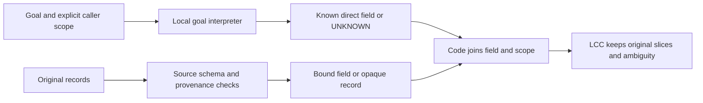

# Semantic goal review and recommended route — 2026-10-08

## Recommendation and research scope

Test a small goal interpreter followed by selection over source-bound fields.
Interpret the question once; let code join a supported field to records. Keep
unknown goals and opaque records. This is a proposed change of task/representation,
not evidence that the architecture already works or replaces Laya/Jev.

The target is useful, efficient local context in engine + LCC. A finite semantic
contract is compatible with that goal, but direct measurement retrieval covers
only part of LCC's broader relevance decisions. General incident diagnosis and
the sufficiency of a retained set remain open. The failed historical gates are
unchanged; narrowing a future prototype cannot make those results pass.

## What was actually reviewed

`review.py` checks the saved train/validation inputs against all 96 original raw
fixtures, with no tool recapture or model inference. It extracts a fixed 96-case
validation sample: 8 fields × 2 query languages × (positive, negative, three semantic
UNKNOWN kinds, one malformed-record kind). Positives prefer contradictory values;
negatives prefer original measurements; selection then uses ID without scores.
All 4 actual DROP rows are added as a separate supplemental sample, for 100 rows.
This coverage sample is not a random prevalence estimate or 100 independent tasks.

The semantic assessment is by the same coding agent, informed by source definitions
and official references. **It is not independent human labeling.** Source/raw/
input/selection integrity checks pass. There are no conflicting question targets
under the authored contract. A separate gzip/JSON recount confirms these counts:

| Population | Rows | Distinct direct questions, entity suffix removed | Direct questions per field, both languages |
| --- | ---: | ---: | ---: |
| Train | 11,136 | 256 | 32 |
| Validation | 5,568 | 240 | 30 |

Different counter values, captions, entities and swaps multiply pair rows without
creating new natural questions. The total distinct question populations are
1,172/1,136 including UNKNOWN and structural cases. Some structural questions
overlap direct questions. Row count does not establish semantic diversity or the
number of independent observations. Counts alone do not prove a cause of failure.
The current loss already balances classes globally after deduplication; a high
UNKNOWN fraction is not sufficient evidence of an unbalanced-loss bug.

Receipts: `protocol.json`, `summary.json`, `cases.json`,
`independent-count-check.json`, `compatibility-probe.json`, `verification.json`.
The automated claim gate returned **BLOCK (.65 support)** for publishing the
combined counts/compatibility statement as MEASURED: it requests repeated
measurement or an independent source. Its required label is
`INFERIDO — nao medido (falta medicao repetida ou fonte independente)`;
see `result-claim-gate.json`. Preserve the local receipts and treat this review as
exploratory evidence, without independent scientific certification. No retry or
change of the claim gate was made. The architecture recommendation remains a
hypothesis. All review annotations
are diagnostic targets; none enter a candidate's inference or training.
The extractor/probe's zero API/model-call counts exclude the one supplementary
external Jev claim-gate call. Its receipt does not record token/cache accounting;
it is not model-quality or independent semantic-label evidence.

## Findings

**1. Two language interpretations are combined in every model input.**
[Projection](../../measurement_projection.py) validates caller entity/syntax but
passes only the natural question and `measurement prose: value` to the model
(lines 46–56). The canonical source field and unit live in the supervision binding,
not the submitted strings. Thus a ranking error may involve question interpretation,
caption interpretation, the relation between them or support gating. The saved
two logits do not locate these errors independently. Their separation in the loss
does not make their shared encoder or pair inputs independent.

**2. The reviewed literal field targets largely make sense, with scope caveats.**
No definite swapped source-field label was found in the 32 binary coverage cases.
Attempts/failures, scheduled/actual waits, datagrams/payload bytes and staged/
worktree paths are distinct under the captured definitions. Relevant false values
remain relevant: filtering them as impossible would erase contradictory evidence.

| Fields | Meaning to preserve |
| --- | --- |
| Retry attempts / failures | All protected-operation calls, including a terminating success or failure / only calls that raised |
| Scheduled / actual waiting | Sum of requested intervals / monotonic sleeper-callback entry-to-exit durations, excluding operation calls |
| Sent UDP datagrams / bytes | Successful local send events, including empty datagrams / application payload lengths, excluding headers |
| Git staged / worktree paths | HEAD-to-index changes / index-to-disk changes; additions/deletions and tracked-path scope must be explicit |

Some captions weaken that precision. Git captions saying "modified" may be read
as status M alone even though these counts include additions/deletions; see sample
cases 0/3 and the [Git status definition](https://git-scm.com/docs/git-status/2.45.0).
Some English duration captions omit the unit, while the recorded integer uses
nanoseconds; case60 is an example. UDP "transmitted" should explicitly mean local
`sendto` submission, not successful receipt. Python documents the
[sendto return](https://docs.python.org/3.13/library/socket.html#socket.socket.sendto),
and [RFC768](https://www.rfc-editor.org/info/rfc768/) does not guarantee delivery.
These are future wording/contract corrections, not proven explanations of the
observed quality failure. Historical strings and labels remain unchanged.

**3. There are clear model failures, even on an unambiguous reviewed query.**
Supplemental IDs `1a531b981b4f…` and `935ca02d20a4…` ask in Portuguese for the
observed retry pause duration in nanoseconds. Both matching captions say observed
time inside the sleeper in nanoseconds. The policy drops the true 5,803,500 ns
record and its contradictory 3,000,000 ns value swap. This is direct evidence of
failed relevance/retention on those inputs, not a causal diagnosis of the encoder.
The 2 negative DROP rows are one duplicated effective input under the same Git
query; all 4 DROP rows represent 3 effective inputs and 2 questions, not 4 independent
errors. The original row-denominator metrics remain valid as defined.

**4. UNKNOWN has two materially different meanings.**
The 48 semantic-UNKNOWN coverage cases ask for derivation, explanation or broader
analysis. Abstention is correct under the direct-record contract, even if those
records could help a larger task. The 16 structural cases have valid direct-field
questions but malformed records missing `level`. An interpreter trained only on
goals must not label those questions unsupported merely because the pair's label
is UNKNOWN. Query support and record validity require separate targets.

The [UNKNOWN templates](../../wording_development_pilot.py) explicitly label
broader context usefulness unsupported. More epochs on that target do not teach
general LCC relevance. Some composed questions are also unnatural, such as
"Determine por que ocorreu caminhos distintos…". Future data need complete
utterances and genuinely ambiguous/out-of-scope requests, not repeated frames
whose first verb effectively announces the target class.

**5. The existing typed API cannot consume these records unchanged.**
[ObservationRequest](../../../lcc_engine/observations.py) requires entity, field and
UTC start/end; its JSON record grammar requires time, level, entity, field, value,
unit (lines 32–58). Pilot JSON has entity, level, measurement, value; prose has no
timestamp either. A compatibility-only probe with one literal valid request keeps
all 5,568 validation rows UNKNOWN and drops none. Its request's UTC range is synthetic,
not a claimed capture timestamp. Adding a classifier in front of this API does
not bridge the record-schema gap.

## Alternatives

| Approach | What it can answer | Limitation / decision |
| --- | --- | --- |
| Goal interpreter + source-bound selection | Whether a natural request maps to a known recorded field; record selection becomes inspectable | Recommended probe; needs trusted field adapters, new labels and explicit unsupported scope |
| Continue the pair cross-encoder | General question/caption relation, potentially broader inputs | Useful control; more of the same does not isolate the transfer failure or reduce per-block semantic work |
| Refit scores/cutoffs per goal | Differences of score scale between questions | Cannot fix within-goal ordering or missing record metadata; diagnostic only at this stage |

## Proposed flow



The interpreter reads goal text and a public fixed field registry, plus caller
identity already supplied explicitly. It never receives `requested_role`, labels,
fact_truth or desired decisions from benchmark annotations. In an initial
eight-field study it may select a supported direct field or abstain. Canonical
field bindings must come from genuine tool schemas/collector definitions,
independently verified against raw events. They cannot be copied from dataset
labels into arbitrary prose. Records without such bindings remain opaque/KEEP.

Reuse the existing parser/projection and original-slice retention principles.
Tool captures without an observed UTC window use a declared capture/instance
scope; do not fabricate timestamps or silently reinterpret ObservationRequest.
If a producer already supplies valid UTC records, reuse that API directly. A
record's questionable value is not grounds to discard a matching-field record.
Broader goals retain context; this prototype does not plan an incident investigation.

The efficiency hypothesis is semantic work per distinct goal instead of per
goal/block pair, followed by bounded parsing. It does not imply a smaller weight
file, lower measured latency or native 32K attention. Those require measurement.

## Ordered next experiment and stopping rules

1. **Freeze the registry and support contract.** Define the eight fields, units,
   success/failure semantics, caller scope and unsupported request kinds. Correct
   future ambiguous captions. Prepare complete natural requests, separating
   question targets from record-validity targets. Success: every accepted request
   has one explainable field binding; unresolved ambiguity remains UNKNOWN. Obtain
   independent semantic review before presenting those labels as scientific ground
   truth; none is currently available in these receipts.

2. **Run one goal-only development probe before training.** Reuse the immutable
   multilingual reranker and lexical controls against fixed field/unsupported
   definitions. Only exposed development queries; one protocol, at most 30,000
   local pair forwards, no adaptation or external model calls. Freeze exact
   definitions, token counts, scoring/cutoff recipe and failure accounting first.
   Report field confusion, accepted-binding precision, supported-query coverage
   and unsupported acceptance by language and wording family. Success for the
   eventual router: accepted precision ≥.99 and coverage ≥.80 on supported queries,
   semantic UNKNOWN recognition ≥.95. These are proposed point targets, not a
   confidence guarantee. If the frozen probe fails, inspect errors before deciding
   whether a separately bounded query-only adaptation is justified.

3. **Use fresh query families to confirm an interpreter, then test full selection.**
   Reserve at least 256 complete new requests per language, including supported,
   unsupported, negated, underspecified and out-of-registry requests. Group
   translations/paraphrases of the same intent in one split; count unique queries
   rather than repeated counter values. Have at least 100 accepted unique queries
   per language when estimating precision, and report confidence intervals with
   the point estimate. A small successful sample is not a 1% error guarantee. All
   thresholds must be frozen on separate development before confirmation.

   Provide every compared engine the same canonical metadata; report the schema
   change as a system treatment, not a pure neural-model improvement. Use a
   typed/oracle request only as a labeled diagnostic ceiling, never a prediction.
   Require the original end-to-end semantic pooled/within-goal ≥.90,
   positive/contradiction retention ≥.95, negative DROP ≥.70, semantic UNKNOWN ≥.95,
   structural UNKNOWN 1.0 and zero UNKNOWN DROP by query/report language. A future
   eight-field pass does not certify the old 18-field gate or broader LCC utility.

4. **Only a confirmed useful selector proceeds to LCC outcomes and compression.**
   New full/local/Laya/Jev tasks at 8K/32K/larger; success ≥.90, loss ≤.02,
   removal ≥.25 and UNKNOWN retained. Measure cold/warm latency, full process RSS,
   tokenizer/model/parse calls and full token/cache accounting. Prefer measured
   lower total cost; distillation/quantization follows useful quality. P2 still
   needs reliable replay and independent outcome review.

Do not spend the next cycle on larger attention windows, extra seeds/epochs of
the rejected pilot, new backbones, benchmark-based cutoff fitting or public
performance claims. The first new executable work should be the goal-only probe
after its small protocol is frozen; no production code or new training was
implemented in this review.

Verification: extractor self-check covers structural/direct/unsupported targets
and missing caller scope; full sample/raw/input assertions and separate count
check pass. Scoped Ruff E9/F passes. The first extractor preflight compared a
normalized view's extra hash key incorrectly; `preflight-errors.log` preserves
the failure, corrected before exporting review receipts. No original evidence
changed. The prior 247-test suite remains the last full-suite result; this review
adds only research artifacts. Reproduction in a temporary output directory matches the saved protocol, summary
and all cases apart from creation timestamps, with 20 pinned input/source hashes
checked (`verification.json`). The saved script writes exclusively and refuses
to replace these receipts. From the repository root, reproduce its checks with:

```python
import contextlib, importlib.util, io, json, tempfile
from pathlib import Path
saved = Path("research/goal-engine-2026-10-04/semantic-goal-review-v1").resolve()
spec = importlib.util.spec_from_file_location("semantic_review", saved / "review.py")
module = importlib.util.module_from_spec(spec)
spec.loader.exec_module(module)
with tempfile.TemporaryDirectory() as directory:
    module.OUT = Path(directory)
    with contextlib.redirect_stdout(io.StringIO()):
        module.review()
    for name in ("protocol.json", "summary.json", "cases.json"):
        actual = json.loads((module.OUT / name).read_text())
        expected = json.loads((saved / name).read_text())
        if isinstance(actual, dict):
            actual.pop("created_at_utc", None)
            expected.pop("created_at_utc", None)
        assert actual == expected, name
```
